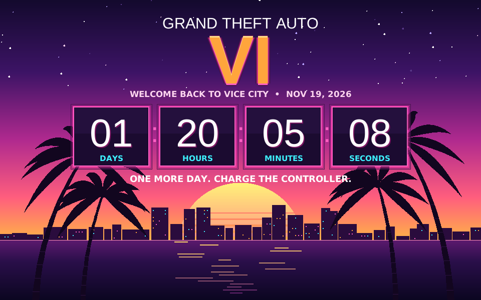

# GTA VI Launch Countdown

A Vice City sunset-themed desktop window that counts down to the launch of
GTA VI: **midnight, November 19, 2026, in your local time zone**.

## Open it (double-click)

**Option 1: prebuilt app (no Python needed)**
1. Go to the repo's **Actions** tab → latest *Build desktop app* run.
2. Download the artifact for your OS and unzip it:
   - **Windows:** `GTA6 Countdown.exe` → double-click.
   - **macOS:** `GTA6 Countdown.app` → double-click. The first time, right-click → **Open**,
     because the app isn't signed.
   - **Linux:** `GTA6 Countdown` → double-click, or run `./"GTA6 Countdown"`.

Push a tag such as `v1.0` and the builds are also attached to a GitHub Release.

**Option 2: run the script**
With Python 3 installed, double-click `gta6_countdown.pyw`. On Windows `.pyw` files
open without a console window. Elsewhere, run `python3 gta6_countdown.pyw`.

Press **Esc** to close the window.

## Changing the date
Edit `LAUNCH = datetime(2026, 11, 19, 0, 0, 0)` near the top of `gta6_countdown.pyw`.

*Fan-made. Not affiliated with Rockstar Games or Take-Two Interactive.*
